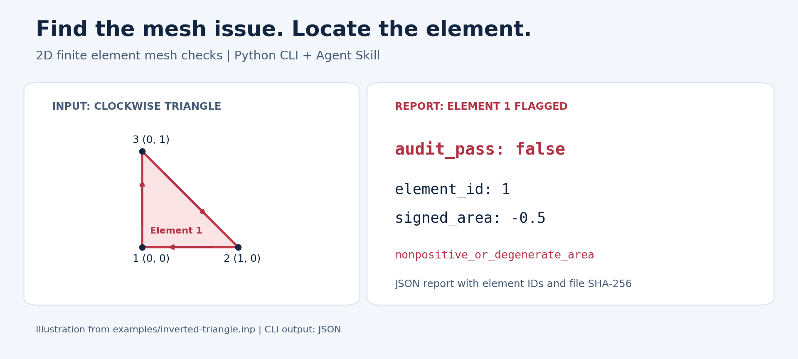

# FEM Mesh Audit

**Find inverted elements, degenerate cells, and duplicate nodes before submitting a 2D finite element job.**

[中文](README.md) · English · [Step-by-step tutorial (Chinese)](docs/mesh-quality-tutorial.zh-CN.md)

[](https://github.com/GaoYishen/abaqus-mesh-audit/actions/workflows/tests.yml)  [](LICENSE)

A lightweight Python mesh quality checker for Abaqus INP files. Get a JSON report with node IDs, element IDs, geometric metrics, and an input SHA-256 hash. Run it from the command line or use the included Agent Skill.



*Illustration based on the included inverted-triangle example. The CLI produces JSON reports.*

**Useful for your work? Star the repository to find it again, or [open an issue](https://github.com/GaoYishen/abaqus-mesh-audit/issues) with feedback or a reproducible example.**

## Quick start

Requires Python 3.10+ and its standard library.

```sh
git clone https://github.com/GaoYishen/abaqus-mesh-audit.git
cd abaqus-mesh-audit
python mesh_audit.py examples/two-triangles.inp
```

On Windows, you can use `py -3` instead of `python`. You can also download and extract the repository ZIP, then open a terminal in the extracted folder.

Audit your own mesh and save a new report:

```sh
python mesh_audit.py your-mesh.inp --output audit.json
```

Choose an unused output filename: reports are created exclusively to preserve previous results.

## What it checks

| Check | Result |
|---|---|
| Signed element area | Nonpositive or degenerate area, with element IDs |
| Minimum interior angle | Small-angle warnings for triangles and quadrilaterals |
| Longest-to-shortest edge ratio | Edge-length imbalance |
| Q4 Jacobians | Four Gauss points, four corners, and the center |
| Exact coincident nodes | Node IDs with identical coordinates |
| Duplicate connectivity | Elements sharing the same node set |
| Non-manifold edges | Edges shared by more than two elements |

The report also includes boundary-edge counts and explicit ELSET element counts.

## Try a failing example

```sh
python mesh_audit.py examples/inverted-triangle.inp
```

The clockwise triangle has signed area `-0.5`. The report includes:

```json
{
  "audit_pass": false,
  "issues": [
    {"kind": "nonpositive_or_degenerate_area", "element_id": 1}
  ]
}
```

The command exits with code 1 because it found a mesh issue. In a copy of this example, changing the connectivity from `1, 1, 3, 2` to `1, 1, 2, 3` gives signed area `0.5` and passes the checks.

Try the passing Q4 example:

```sh
python mesh_audit.py examples/square-q4.inp
```

## Supported input

Explicit, flat XY meshes with z=0 and one numbering scope. Supported element types: `CPE3`, `CPS3`, `CPE4`, `CPE4R`, `CPS4`, `CPS4R`. Node and element records must each fit on one line. Numeric ELSET entries and ELSET GENERATE are supported.

For models using parts, assemblies, instances, INCLUDE, generated coordinates, transformations, or named ELSET references, first export an explicit flat mesh. Higher-order, 3D, and user elements require their corresponding checks.

## Thresholds and result interpretation

```sh
python mesh_audit.py examples/two-triangles.inp --min-angle 20 --max-edge-ratio 10
```

The defaults are screening thresholds; select criteria appropriate to your elements and analysis. The edge-length ratio is specifically longest edge divided by shortest edge. Degeneracy tolerances scale with the square of the longest edge.

| Exit code | Meaning |
|---|---|
| 0 | Declared geometric checks passed |
| 1 | Mesh issues found |
| 2 | Invalid/unsupported input or output error |

Boundary edges can belong to an exterior boundary, a hole, or a crack. Use separate procedures for full intersection searches, material-interface validation, and solution-accuracy assessment.

## Agent Skill

Keep the complete repository and ask your assistant to read [SKILL.md](skills/abaqus-mesh-audit/SKILL.md). The skill calls the root-level Python script.

Example request: “Audit this INP mesh using abaqus-mesh-audit, list issue types and element IDs, and suggest follow-up checks.”

## Tests and preview assets

```sh
python -m unittest discover -s tests -v
```

To rebuild the README illustration, install Matplotlib in your documentation environment and run `python scripts/build_preview.py` from the repository root. Matplotlib is needed only to rebuild these assets; mesh auditing uses the Python standard library.

## Related tools

- [Battery Capacity Audit](https://github.com/GaoYishen/battery-capacity-audit): capacity, N/P ratio, C-rate current, and electrode thickness.
- [Research Simulation Workflows](https://github.com/GaoYishen/research-simulation-workflows): case manifests, file integrity checks, and handoff reports.

## License

[MIT](LICENSE). See [PROVENANCE.md](PROVENANCE.md) for project provenance.
