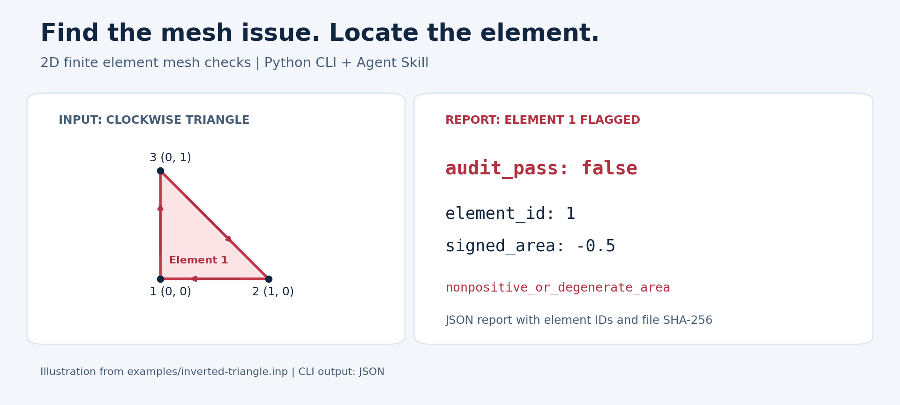

# 有限元网格检查工具 · FEM Mesh Audit

**提交计算前，先找出二维网格中的倒置单元、退化单元和重复节点。**

Read-only 2D finite element mesh quality checks for Abaqus INP files: triangles, quadrilaterals, Jacobians, duplicate nodes, and connectivity.

[中文](README.md) · [English](README.en.md) · [从错误网格到检查报告：完整教程](docs/mesh-quality-tutorial.zh-CN.md)

[](https://github.com/GaoYishen/abaqus-mesh-audit/actions/workflows/tests.yml)  [](LICENSE)

读取 Abaqus `.inp`，把网格问题定位到具体节点或单元，输出 JSON 报告。只需 Python 3.10+ 标准库，可独立运行，也可交给 AI 助手作为 Agent Skill 使用。



*根据仓库倒置三角形示例绘制的说明图；命令行工具输出 JSON 检查报告。*

**这个工具对你有帮助？欢迎点个 ⭐，方便以后找到。希望增加检查项，或遇到输入格式问题，欢迎 [提交 Issue](https://github.com/GaoYishen/abaqus-mesh-audit/issues)。**

## 它能帮你检查什么？

| 你关心的问题 | 工具给出的结果 |
|---|---|
| 节点顺序反了，单元是否倒置？ | 有向面积、异常单元编号 |
| 三角形或四边形是否过尖、过细？ | 最小内角、最长边/最短边比值 |
| Q4 单元局部映射是否异常？ | Gauss 点、角点和中心的 Jacobian 检查 |
| 是否有完全重合节点或重复单元？ | 重合节点及重复连接关系 |
| 是否有超过两个单元共用一条边？ | 非流形边检查 |

## 看一个检查结果

[倒置三角形示例](examples/inverted-triangle.inp)会报告以下问题（节选）：

```json
{
  "audit_pass": false,
  "issues": [
    {"kind": "nonpositive_or_degenerate_area", "element_id": 1}
  ]
}
```

**从“模型可能有问题”到“检查第 1 个单元”**，把检查结果用于定位和修正网格。

## 一分钟上手

```sh
git clone https://github.com/GaoYishen/abaqus-mesh-audit.git
cd abaqus-mesh-audit
python mesh_audit.py examples/two-triangles.inp
```

检查自己的网格并保存报告：

```sh
python mesh_audit.py your-mesh.inp --output audit.json
```

Windows 可用 `py -3` 代替 `python`。输出文件采用新建方式保存；请选择尚不存在的文件名。

## 检查内容

- 非正/退化有向面积、重复连接节点。
- 三角形/Q4 最小内角，最长边/最短边比值。
- Q4 四个 Gauss 点、四角点和中心的 Jacobian。
- 完全重合的节点、相同节点集合的重复单元、超过两个单元共用的非流形边。
- 外露边数量及显式 ELSET 单元数量。

可用 `--min-angle 20 --max-edge-ratio 10` 修改筛查阈值。这些值是示例默认值，不是通用精度保证；边长比也不等于所有软件的 aspect ratio 定义。退化判据按单元最长边平方缩放。

## 支持的输入格式

仅支持单一编号空间的显式 XY 网格：z=0；CPE3、CPS3、CPE4、CPE4R、CPS4、CPS4R。节点/单元记录须在单行内。支持显式数字 ELSET 和 GENERATE。

含 INCLUDE、PART/ASSEMBLY/INSTANCE、坐标变换/生成或命名 ELSET 引用的模型，请先导出为单一编号空间的显式 XY 网格。当前检查对象为上述二维线性常规单元；高阶、三维与用户单元需要对应的专用检查。

## 如何理解结果

退出码 0：已声明的几何检查通过；1：发现网格问题；2：输入不支持/无效或输出失败。报告逐项列出问题和单元指标，并保留输入 SHA-256。

外露边可能是外边界、孔洞或裂缝，不能仅据此判定界面不相容。几何筛查结果用于定位网格问题；完整相交搜索、多相界面验证和求解精度评估需要另行开展。

## Agent Skill

让助手读取 [SKILL.md](skills/abaqus-mesh-audit/SKILL.md)，并保留整个仓库。示例目录提供可直接运行的合成网格。MIT License；见 [PROVENANCE.md](PROVENANCE.md)。


## English overview

A lightweight Python finite element mesh checker for explicit, flat XY Abaqus INP meshes. Supports linear T3 and Q4 elements, signed area, minimum angles, edge-length ratios, sampled Q4 Jacobians, exact coincident nodes, duplicate elements, and non-manifold edges. Reports include element IDs and the input SHA-256 hash. Run locally or use the included Agent Skill.

## 相关工具

- [电池容量与倍率核算](https://github.com/GaoYishen/battery-capacity-audit)：计算容量、N/P、倍率电流与电极厚度。
- [科研仿真记录与交接](https://github.com/GaoYishen/research-simulation-workflows)：建立算例清单，核对文件变化，生成交接报告。
