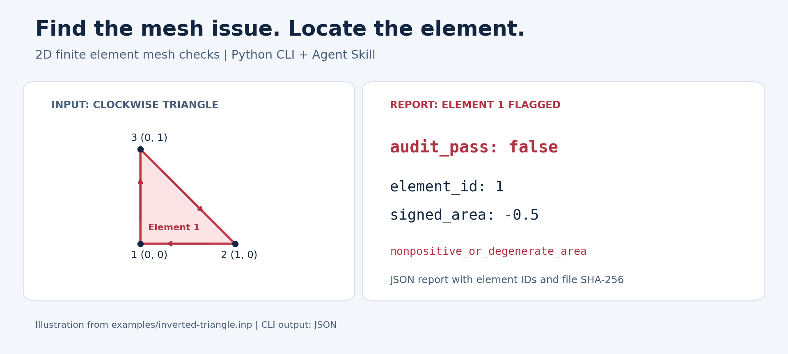

# Python 检查 Abaqus INP 二维有限元网格：倒置单元、重复节点与 Jacobian

做二维有限元计算时，可以先用几何与连接关系筛查定位网格问题。这篇教程用一个可复现的倒置三角形，演示从读取 INP、找到问题单元，到修改副本后重新检查的过程。

工具：[FEM Mesh Audit](https://github.com/GaoYishen/abaqus-mesh-audit)。运行需要 Python 3.10 或更新版本，使用标准库。



图为根据示例数据制作的说明图。工具本身输出 JSON，包含具体单元编号，便于回到建模或网格软件中定位。

## 1. 下载并运行一个正常网格

```sh
git clone https://github.com/GaoYishen/abaqus-mesh-audit.git
cd abaqus-mesh-audit
python mesh_audit.py examples/two-triangles.inp
```

也可以从 GitHub 下载 ZIP 并解压，在解压目录打开终端。Windows 可将命令中的 `python` 换成 `py -3`。

正常示例的报告中，`audit_pass` 为 `true`、`issues` 为空，进程退出码为 0。

## 2. 检查一个节点顺序反向的三角形

[倒置示例](../examples/inverted-triangle.inp)包含三个节点：

```text
*Node
1, 0, 0
2, 1, 0
3, 0, 1
*Element, type=CPE3
1, 1, 3, 2
```

最后一行表示第 1 个单元按 `1 → 3 → 2` 连接，沿 XY 平面为顺时针。运行：

```sh
python mesh_audit.py examples/inverted-triangle.inp
```

结果节选：

```json
{
  "audit_pass": false,
  "issues": [
    {"kind": "nonpositive_or_degenerate_area", "element_id": 1}
  ]
}
```

完整报告中的第 1 号单元有向面积为 `-0.5`，进程退出码为 1。这里的 1 是“发现网格问题”，可以据此在批处理流程中暂停后续步骤。

## 3. 在副本中修改连接顺序并复查

将示例复制为 `fixed-triangle.inp`，只在副本中把连接行改成：

```text
1, 1, 2, 3
```

再运行：

```sh
python mesh_audit.py fixed-triangle.inp --output fixed-audit.json
```

这时有向面积为 `0.5`，`audit_pass` 为 `true`。`--output` 新建结果文件；再次运行时请选择新的输出文件名。

对于这里的单个 CPE3 示例，交换顺序可修正方向；实际模型请依据相应单元的连接约定修改，并复查边界和集合定义。

## 4. 除了倒置，还检查什么？

| 检查项 | 看什么 |
|---|---|
| 有向面积 | 非正面积与退化单元 |
| 最小内角 | 过尖的三角形或四边形 |
| 最长边 / 最短边 | 边长尺度差异 |
| Q4 Jacobian | 四个 Gauss 点、四个角点和中心的局部映射 |
| 完全重合节点 | 坐标完全相同的不同节点编号 |
| 重复单元连接 | 使用相同节点集合的多个单元 |
| 非流形边 | 超过两个单元共用的边 |

也可运行 Q4 示例：

```sh
python mesh_audit.py examples/square-q4.inp
```

根据应用选择筛查阈值，例如：

```sh
python mesh_audit.py examples/two-triangles.inp --min-angle 20 --max-edge-ratio 10
```

20° 和 10 为示例默认阈值。实际阈值应结合单元类型和求解任务选择；最长边/最短边比值也有别于某些软件的 aspect ratio 定义。

## 5. 检查自己的网格

准备单一编号空间、显式节点与单元记录的 XY 网格，支持 `CPE3`、`CPS3`、`CPE4`、`CPE4R`、`CPS4`、`CPS4R`，z 坐标为 0。

若原始模型使用 Part、Assembly、Instance、INCLUDE 或坐标变换，请先导出为该形式的扁平网格。

```sh
python mesh_audit.py your-mesh.inp --output your-mesh-audit.json
```

报告保留输入文件 SHA-256，可用于核对这次检查对应哪份网格。退出码含义：0 为声明的几何检查通过，1 为发现问题，2 为输入格式或文件读写错误。

这些结果用于几何和连接筛查。完整的单元相交搜索、材料界面验证与有限元解精度评估各有对应的验证步骤。

## 6. 在 AI 助手中使用

保留整个仓库，让支持 Agent Skills 的助手读取 [SKILL.md](../skills/abaqus-mesh-audit/SKILL.md)。可以这样提出任务：

> 按 abaqus-mesh-audit 检查这个 INP，列出问题类型、单元编号和下一步检查建议。

## 反馈与收藏

如果这个教程帮你定位了问题，欢迎给 [项目点个 Star](https://github.com/GaoYishen/abaqus-mesh-audit)，方便下次找到。欢迎在 [Issue](https://github.com/GaoYishen/abaqus-mesh-audit/issues) 分享使用场景；提交问题时附上最小可复现输入、执行命令和预期结果。

[返回 README](../README.md) · [English guide](../README.en.md)
